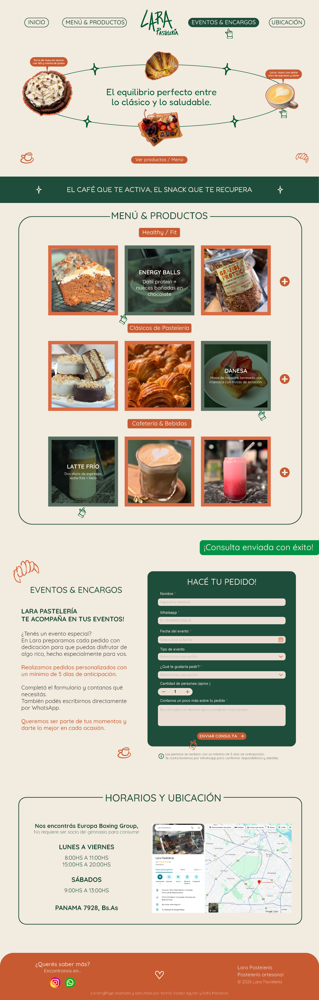
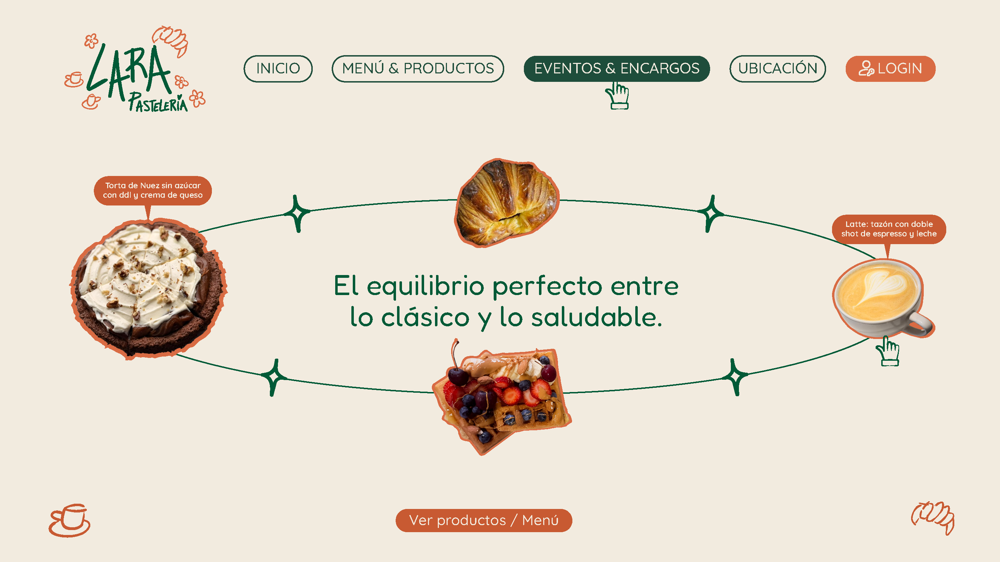
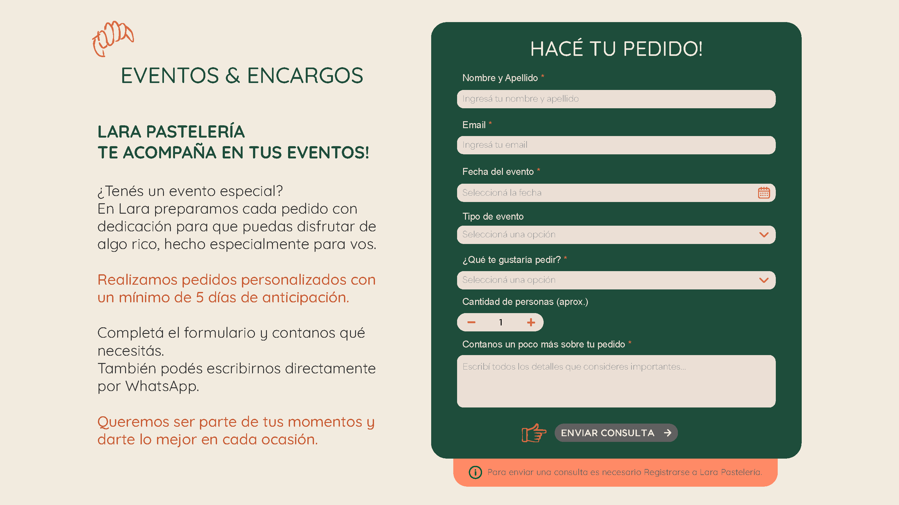
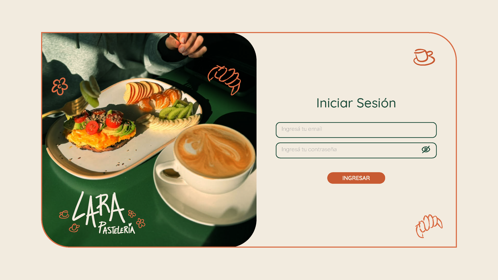
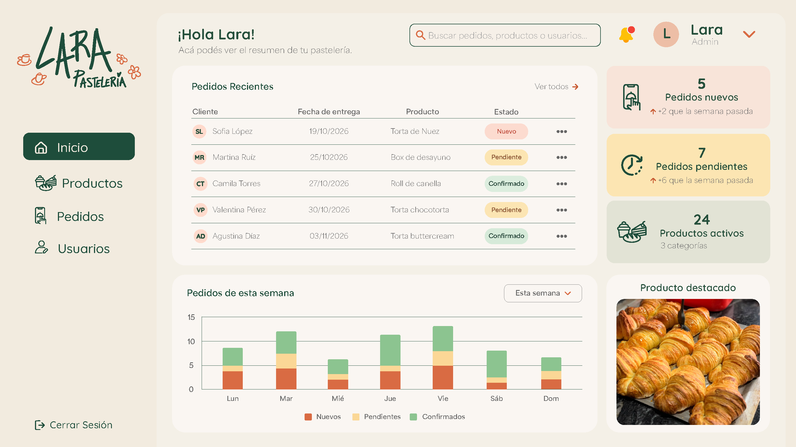
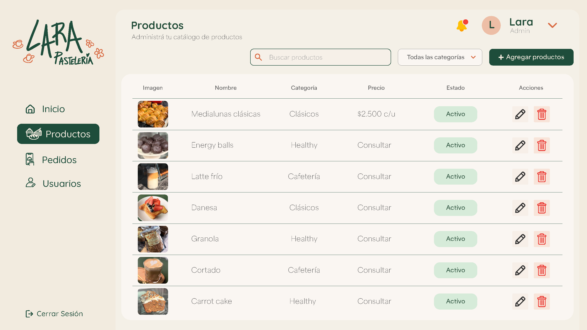
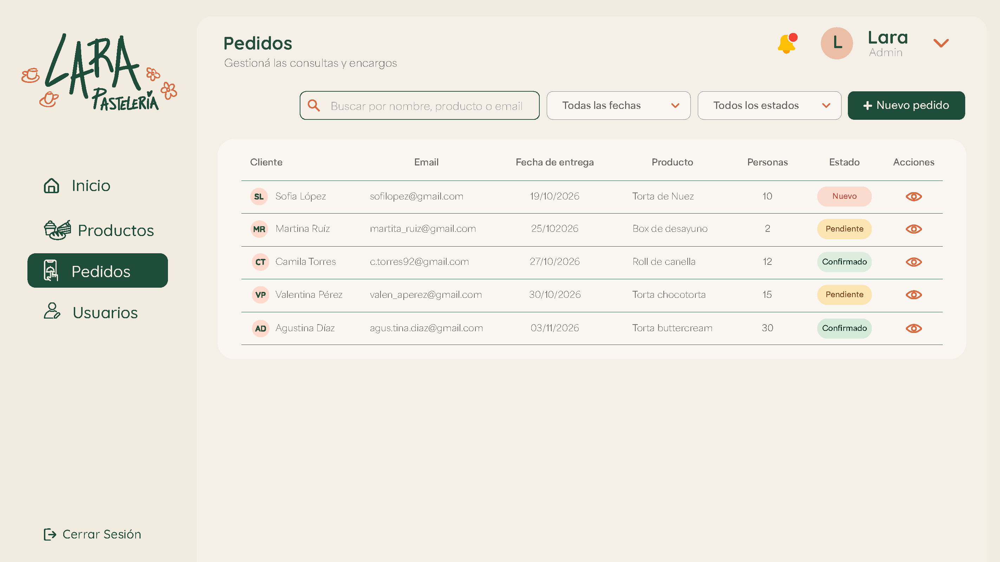
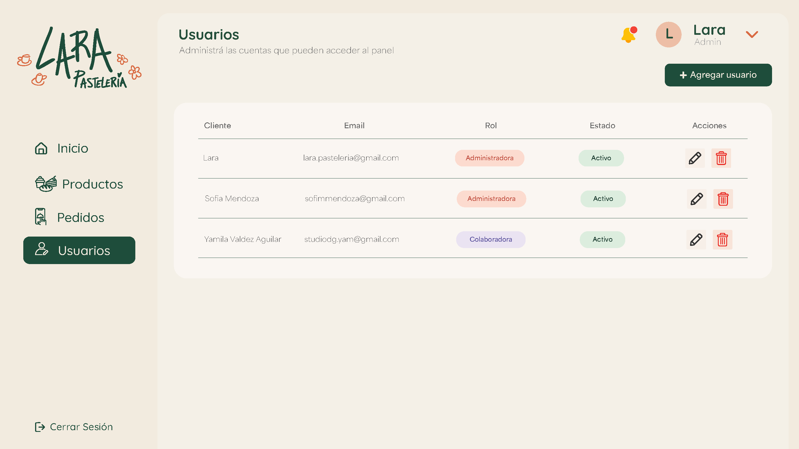

# 🌸 Lara Pastelería

Aplicación web para Lara Pastelería, un emprendimiento que combina pastelería clásica, opciones saludables y cafetería.

Incluye una landing pública, registro e inicio de sesión de clientes y un panel administrativo para gestionar productos, pedidos y cuentas administradoras.

El sistema permite enviar consultas por encargo. Completar el formulario no confirma el pedido: Lara informa disponibilidad y presupuesto.

No incluye carrito ni pagos online.

## Sitio y repositorios

| Recurso | Dirección |
|---|---|
| Sitio publicado | https://lara-pasteleria.vercel.app |
| Login de clientes | https://lara-pasteleria.vercel.app/login |
| Registro de clientes | https://lara-pasteleria.vercel.app/registro |
| Login administrativo | https://lara-pasteleria.vercel.app/admin/login |
| API publicada | https://lara-backend-5tq4.onrender.com |
| Estado de la API | https://lara-backend-5tq4.onrender.com/api/health |
| Repositorio frontend | https://github.com/sofiimendo/lara-pasteleria |
| Repositorio backend | https://github.com/sofiimendo/lara-backend |

## Tecnologías

| Tecnología | Uso |
|---|---|
| React y JSX | Componentes e interfaces |
| React Router | Navegación y rutas |
| Zustand | Estado del formulario de pedidos |
| Vite | Desarrollo y compilación |
| CSS y SCSS | Diseño responsive y estilos |
| Fetch API | Comunicación con el backend |
| pnpm | Gestión de dependencias |
| Git y GitHub | Versionado y trabajo colaborativo |
| Vercel | Publicación del frontend |
| Render | Publicación del backend |
| MongoDB Atlas | Persistencia de datos mediante la API |
| Cloudinary | Almacenamiento de imágenes mediante el backend |

El backend utiliza Node.js, Express, Mongoose, Zod, JWT, bcrypt, express-rate-limit y Multer. Su configuración y sus pruebas se documentan en el repositorio `lara-backend`.

## Funcionalidades

### Landing pública

- Presentación del emprendimiento.
- Productos destacados con animaciones e interacciones.
- Menú organizado por categorías.
- Formulario de consultas autenticado.
- Ubicación, horarios y contacto.
- Diseño adaptado a computadoras y celulares.

### Menú y productos

El menú mantiene dos secciones diferenciadas.

#### Productos del local

- Consulta `GET /api/productos`.
- Muestra los productos disponibles administrados desde el panel.
- Presenta nombre, descripción, imagen y precio.
- Agrupa los productos por categoría.
- Incluye navegación entre tarjetas.
- Muestra estados de carga, error y listado vacío.
- Permite reintentar si falla la conexión.

La consulta se realiza al montar el componente. Para comprobar cambios hechos desde otra ventana, se debe recargar la landing.

#### Catálogo original

- Conserva los productos precargados del frontend.
- Utiliza `src/data/productosMenu.js` y `src/data/catalogoLara.js`.
- Mantiene imágenes, descripciones y presentaciones.
- Contempla precios a consultar, precios “desde” y distintos tamaños.
- Conserva las indicaciones de anticipación y seña cuando corresponden.

Esta separación es una transición. El catálogo original todavía no se administra desde el panel y puede contener productos equivalentes a los de la sección conectada a la API.

Desactivar o eliminar un producto del panel afecta a su registro en “Productos del local”; no modifica los datos independientes del catálogo original.

### Clientes

- Registro de cuentas.
- Inicio y cierre de sesión.
- Validación de confirmación de contraseña en el registro.
- Envío de consultas con token de cliente.
- Sesión de cliente separada de la administrativa.

### Formulario público de pedidos

- Nombre y email de contacto.
- Fecha de entrega.
- Tipo de evento.
- Tipo de pedido.
- Cantidad aproximada de personas.
- Detalles adicionales.
- Mensajes de validación y resultado del envío.

La API vincula cada pedido con el cliente autenticado. El email de contacto no determina la propiedad del pedido.

Las tortas y medialunas requieren al menos cinco días de anticipación. Las demás opciones admiten fechas desde hoy. El backend calcula estas reglas según Buenos Aires.

### Panel administrativo

#### Inicio / Dashboard

- Resumen de pedidos.
- Contadores por estado.
- Pedidos recientes.
- Gráfico de pedidos.
- Resumen de productos activos.

#### Productos

- Listado administrativo de productos disponibles y no disponibles.
- Búsqueda por nombre y filtro por categoría.
- Creación y edición.
- Precio, descripción, categoría y disponibilidad.
- Selección y vista previa de imágenes.
- Subida de imágenes mediante el backend a Cloudinary.
- Eliminación con confirmación.

La carga admite JPG, PNG y WebP de hasta 5 MB.

Eliminar un producto no elimina automáticamente sus imágenes de Cloudinary.

#### Pedidos

- Listado y búsqueda.
- Filtros por fecha y estado.
- Consulta de detalles.
- Identificación de pedidos web y presenciales.
- Cambio de estado.
- Creación de pedidos presenciales desde una cuenta administradora.

Los pedidos presenciales requieren al menos un contacto: email o teléfono.

El backend contempla una confirmación administrativa para tortas y medialunas con menos de cinco días de anticipación. No permite fechas pasadas.

La pantalla actual permite consultar detalles y cambiar estados. La edición de los datos y la eliminación de pedidos desde el frontend siguen pendientes, aunque la API dispone de esas operaciones.

#### Usuarios

- Listado de cuentas administradoras.
- Búsqueda por nombre o email.
- Creación de administradores.
- Edición de nombre, email y estado activo/inactivo.
- Eliminación con confirmación.

El backend impide que una cuenta administradora se elimine o se desactive a sí misma.

#### Perfil y navegación

- Menú lateral compartido.
- Navegación adaptada a celular.
- Menú del perfil con cierre de sesión.
- Login administrativo con diseño propio.
- Botón para mostrar y ocultar la contraseña.

La campanita es un elemento visual marcado como “Notificaciones: próximamente”. No implementa notificaciones.

## Rutas del frontend

| Ruta | Pantalla |
|---|---|
| `/` | Landing |
| `/registro` | Registro de clientes |
| `/login` | Login de clientes |
| `/admin/login` | Login administrativo |
| `/admin` | Dashboard |
| `/admin/productos` | Administración de productos |
| `/admin/pedidos` | Administración de pedidos |
| `/admin/usuarios` | Administración de usuarios |

El acceso al panel requiere una sesión administrativa. Las autorizaciones de las operaciones se verifican también en el backend.

## Instalación y ejecución local

### Requisitos

- Node.js.
- pnpm.
- Git.
- Backend disponible para utilizar las funciones conectadas.

### Clonar e instalar

```bash
git clone https://github.com/sofiimendo/lara-pasteleria.git
cd lara-pasteleria
pnpm install
```

Si el entorno administra pnpm mediante Corepack, se puede utilizar `corepack pnpm` en los comandos.

### Dirección de la API

El frontend utiliza `VITE_API_URL` como URL base, sin `/api` y sin barra final.

Para utilizar el backend publicado, se puede configurar en un archivo local `.env.local`:

```env
VITE_API_URL=https://lara-backend-5tq4.onrender.com
```

Si la variable no está definida, los componentes utilizan:

```text
http://localhost:4000
```

Las rutas agregan `/api` en sus solicitudes.

`VITE_API_URL` es una configuración pública del frontend. No deben colocarse contraseñas, tokens, credenciales de MongoDB ni secretos de Cloudinary en variables con prefijo `VITE_`.

### Iniciar el frontend

```bash
pnpm dev
```

Vite informa la dirección disponible, normalmente:

```text
http://localhost:5173
```

La terminal debe permanecer abierta mientras se utiliza el servidor local.

Si se modifica la configuración de entorno, se debe reiniciar Vite.

### Utilizar el backend local

El backend se ejecuta desde su propio repositorio:

```bash
pnpm dev
```

Frontend y backend requieren terminales independientes.

Para comprobar el backend local:

```bash
curl --max-time 10 -i http://localhost:4000/api/health
```

Las variables configuradas en Render no se copian automáticamente al entorno local.

La carga de imágenes local requiere configurar de forma privada las variables de Cloudinary en el backend. Durante una prueba se comprobó que, sin esa configuración, la subida falla aunque el frontend abra correctamente.

## Compilación

```bash
pnpm build
```

La compilación genera `dist/`.

Para previsualizarla:

```bash
pnpm preview
```

La compilación correcta comprueba que el proyecto puede construirse; no reemplaza las pruebas funcionales.

## Despliegue

### Frontend en Vercel

- Repositorio: `lara-pasteleria`.
- Rama de producción: `main`.
- Compilación con Vite.
- Directorio de salida: `dist`.
- Variable configurada: `VITE_API_URL`.
- Valor utilizado: `https://lara-backend-5tq4.onrender.com`.

Los cambios en esta variable requieren un nuevo despliegue para incorporarse a la compilación.

### Rutas de React

El archivo `vercel.json` permite abrir directamente y recargar las rutas del frontend:

```json
{
  "rewrites": [
    {
      "source": "/(.*)",
      "destination": "/index.html"
    }
  ]
}
```

Se corrigió el 404 que aparecía al abrir directamente el login administrativo publicado.

### Backend en Render

La API se publica por separado desde `lara-backend`.

El backend tiene configurado el origen público del frontend mediante `FRONTEND_URL`:

```text
https://lara-pasteleria.vercel.app
```

Las credenciales de MongoDB, JWT y Cloudinary se administran de forma privada en el backend.

## Estructura principal

```text
lara-pasteleria/
├── docs/
│   ├── disenio-original.png
│   ├── landing-actualizada/
│   │   ├── pantalla-principal.png
│   │   └── formulario-pedidos.png
│   └── panel-admin/
│       ├── dashboard.png
│       ├── login-admin.png
│       ├── pedidos.png
│       ├── productos.png
│       └── usuarios.png
├── public/
├── src/
│   ├── assets/
│   ├── components/
│   │   ├── Header/
│   │   ├── Inicio/
│   │   ├── Separador/
│   │   ├── Menu/
│   │   ├── Pedidos/
│   │   ├── Ubicacion/
│   │   └── Footer/
│   ├── data/
│   │   ├── catalogoLara.js
│   │   ├── productosMenu.js
│   │   └── configuracion.js
│   ├── layouts/
│   │   ├── AdminLayout.jsx
│   │   └── AdminLayout.css
│   ├── pages/
│   │   ├── admin/
│   │   └── clientes/
│   ├── store/
│   ├── styles/
│   ├── App.jsx
│   └── main.jsx
├── package.json
├── pnpm-lock.yaml
├── vercel.json
└── vite.config.js
```

## Pruebas manuales confirmadas

Resultados registrados durante la integración del 20 y 21 de octubre de 2026.

### Web publicada: Vercel y Render

| Área | Resultado comprobado |
|---|---|
| Login administrativo | Inicio de sesión y acceso al panel |
| Diseño del login | Diseño nuevo visible en producción |
| Perfil | Apertura del menú con mouse y cierre de sesión |
| Productos | Listado con imágenes |
| Productos | Creación de un producto temporal con foto |
| Productos | Edición de nombre, precio y foto |
| Productos | Conservación de los cambios después de recargar |
| Productos | Eliminación y ausencia después de recargar |
| Pedidos presenciales | Creación desde el panel |
| Pedidos presenciales | Consulta de detalles y origen local físico |
| Estados | Cambio a pendiente y conservación al recargar |
| Dashboard | Pedido reciente y contador de pendientes actualizados |
| Usuarios | Listado, creación y edición de una cuenta temporal |
| Usuarios | Cambio a inactivo conservado al recargar |
| Usuarios | Eliminación de la cuenta temporal |
| Clientes | Registro e inicio de sesión |
| Pedidos web | Envío desde una sesión cliente |
| Pedidos web | Recepción en el panel con origen web, email y estado nuevo |
| Pedidos web | Cambio a confirmado conservado al recargar |
| Menú publicado | Visualización de “Productos del local” y “Catálogo original” |

### Pruebas locales

- Compilación de producción correcta con `pnpm build`.
- Verificación de formato con `git diff --check`.
- Mostrar y ocultar la contraseña en el login.
- Corrección del clic del perfil en escritorio.
- Apertura del perfil en modo celular.
- Visualización del producto temporal de la API en el menú, con su precio.
- Desaparición de ese producto al marcarlo como no disponible y recargar.
- Funcionamiento de los controles de tarjetas en modo celular para ambas secciones.

La visualización de las dos secciones se confirmó también después de publicar el menú. La prueba específica de desactivación y los controles móviles de esa nueva integración se realizaron en local.

### Limpieza de datos de prueba

- Se eliminó el producto temporal utilizado para crear y editar con imágenes.
- Se eliminó el producto “Prueba conexión menú”.
- Se eliminó la cuenta administradora temporal de la prueba de Usuarios.
- Quedan pendientes de retirar los pedidos temporales “sofi prueba web” y “Prueba cliente web”.
- Las cuentas cliente creadas para las pruebas deben revisarse antes del uso real.
- La eliminación de productos no implica la eliminación de sus imágenes en Cloudinary.

## Pendientes y límites actuales

- Incorporar al frontend la edición de datos y eliminación de pedidos.
- Migrar el catálogo original a una administración unificada, conservando presentaciones, precios a consultar y precios “desde”.
- Resolver los productos equivalentes que pueden aparecer en ambas secciones durante la transición.
- Repetir en producción las pruebas específicas de disponibilidad y controles móviles del menú conectado.
- Completar la revisión responsive de todos los flujos en dispositivos reales.
- Completar los escenarios de errores y límites de subida de imágenes.
- Completar las verificaciones pendientes de autenticación, recuperación de bloqueos y límites detrás del proxy de Render.
- Revisar el tratamiento de imágenes que quedan almacenadas después de editar o eliminar productos.
- Actualizar la documentación y colección Postman del backend con los resultados más recientes.
- Retirar los datos temporales pendientes.

Las pruebas de seguridad detalladas del backend se registran en su repositorio. No se presentan como pruebas de la interfaz publicada los resultados obtenidos únicamente desde scripts o Postman.

## Alcance

El proyecto incluye consultas de pedidos web y carga administrativa de pedidos presenciales.

No implementa:

- Carrito.
- Checkout o pagos online.
- Control de stock de ingredientes.
- Gestión de recetas y producción.
- Registro contable de ingresos, egresos o costos.
- Integración con el repositorio anterior `lara-stock`.
- Notificaciones funcionales mediante la campanita.

Las indicaciones de seña y presupuesto del catálogo son información para coordinar con Lara; no representan un sistema de cobro.

## Trabajo colaborativo

El desarrollo utiliza ramas por tarea, commits descriptivos y Pull Requests para integrar los cambios en `main`.

El frontend y el backend se mantienen en repositorios separados.

## Diseño de referencia

El sitio utiliza una identidad visual compartida, con tonos verdes, beige y terracota, tipografías Fredoka y Quicksand con recursos gráficos propios.

## Diseño original de la landing

La propuesta original de Lara Pastelería se conserva como referencia para el desarrollo del proyecto.



## Evolución de la landing e integración con el backend

A partir de la landing existente, se realizaron adaptaciones para incorporar las funcionalidades necesarias para su integración con el backend, sin modificar la identidad visual original.

Se incorporaron accesos para el registro e inicio de sesión de clientes y se adaptó el formulario de eventos y encargos para permitir la gestión de pedidos mediante la API.

Estas modificaciones respetan la distribución de los elementos, la paleta de colores, las tipografías Fredoka y Quicksand, las imágenes y la estética de los botones del diseño original.

## Actualización de la pantalla principal:



Actualización del formulario de pedidos:



## Diseño de referencia del panel administrativo

Como parte de la integración del frontend con el backend, se desarrolló una propuesta visual para el panel administrativo de Lara Pastelería.

El objetivo fue crear una interfaz que permitiera visualizar y gestionar la información del sistema de manera clara e intuitiva, manteniendo la identidad visual de la landing original.

Para su diseño se tomaron como referencia los mismos colores, tipografías, recursos gráficos, botones y criterios de distribución utilizados en la landing, buscando mantener una experiencia visual coherente entre ambas interfaces.

A partir de estas propuestas se desarrollaron las pantallas funcionales del panel administrativo.

Login administrativo — Acceso protegido al panel.



Dashboard — Resumen general de la actividad y los pedidos.



Productos — Administración del catálogo.



Pedidos — Consulta y seguimiento de los encargos.



Usuarios — Administración de las cuentas autorizadas.



Las imágenes anteriores representan los diseños utilizados como punto de partida para desarrollar el frontend del panel administrativo, conectado con la API REST y la base de datos MongoDB.

De esta manera, el proyecto mantiene una identidad visual unificada entre la landing pública, las funcionalidades para clientes y las herramientas de administración.

## Desarrolladoras

### Sofía Mendoza

- GitHub: [@sofiimendo](https://github.com/sofiimendo).
- Desarrollo del backend y pruebas.
- Integración entre frontend, API y despliegues.
- Implementación de componentes y ajustes del frontend.

### Yamila Valdez Aguilar

- Diseño e identidad visual.
- Desarrollo de la landing y del panel administrativo.
- Implementación de Usuarios y carga de imágenes.
- Adaptación responsive e integración de componentes.

Proyecto desarrollado por Sofía Mendoza y Yamila Valdez Aguilar en el marco de la formación en desarrollo web.

## Estado actual

Frontend publicado en Vercel y conectado a la API de Render.

Los flujos principales indicados en las pruebas manuales están comprobados. El catálogo mantiene una transición entre datos de la API y datos precargados, y continúan pendientes las tareas detalladas en este documento.

🌸 Opciones saludables, clásicas y cafecitos.